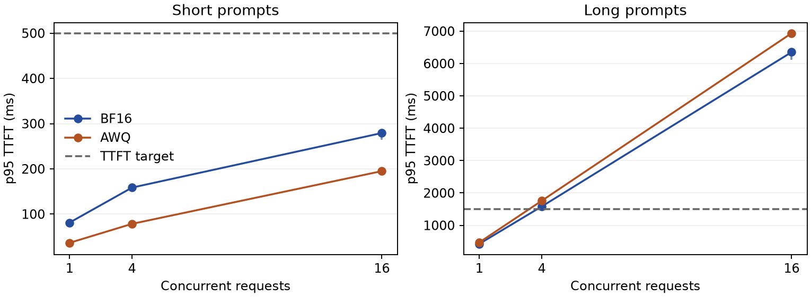

<div align="center">

# ModelScope

**Single-GPU streaming and quantization benchmarks**

[](https://colab.research.google.com/github/ANUVIK2401/modelscope/blob/main/notebooks/modelscope_colab.ipynb)
[](https://github.com/ANUVIK2401/modelscope/actions/workflows/ci.yml)
[](LICENSE)
[](tests/)
[-yellow.svg)](CONTRIBUTING.md)
[](https://www.python.org/)

[**Run it**](#run-it) · [**The hypothesis**](#the-mechanism-under-test) · [**What broke**](#what-this-project-fixed-about-itself) · [**Paper**](paper/paper.md) · [**Limits**](#limitations)

</div>

---

ModelScope measures how model precision affects inference latency, throughput, and GPU
memory. It also studies whether FP16 weight statistics predict layer-level quantization error.

## Qwen3-8B streaming on one Cloud Run L4

AWQ Marlin delivered the highest measured goodput on both workloads. At concurrency 16,
short-prompt goodput rose from 3.55 to 7.74 successful requests per second within 500 ms.
At concurrency 4, long-prompt goodput rose from 0.60 to 0.98 within 1,500 ms. Long-prompt
AWQ p95 was 1,759 ms at concurrency 4. With a 1,500 ms p95 ceiling, use AWQ at concurrency 1.



| Workload and concurrency | BF16 goodput | AWQ goodput | BF16 p95 TTFT | AWQ p95 TTFT |
|---|---:|---:|---:|---:|
| Short, concurrency 16 | 3.55 req/s | 7.74 req/s | 279 ms | 195 ms |
| Long, concurrency 4 | 0.60 req/s | 0.98 req/s | 1,582 ms | 1,759 ms |
| Long, concurrency 1 | 0.23 req/s | 0.45 req/s | 427 ms | 471 ms |

All 384 timed requests across the pair completed with zero errors. The
synthetic exact-match check scored 28/40 for BF16 and 33/40 for AWQ. vLLM reported
15.27 GiB and 5.71 GiB of model-load memory respectively.

[Paired report and raw samples](results/l4-qwen-paired/REPORT.md) ·
[Reproduction protocol](docs/benchmark-reproduction.md)

With AWQ at concurrency 4, prefix caching cut warm shared-prefix p95 first-token
latency from 1,217 to 67 ms and increased goodput from 1.11 to 2.14 req/s. The
first pass over unique prefixes stayed near 1.10 req/s with caching.
[Cache on/off report](results/l4-qwen-prefix/REPORT.md)

## Measured Colab T4 baseline

Llama 3.2 3B Instruct ran on one Colab T4 using FP16 and bitsandbytes NF4.
NF4 reduced post-load device VRAM by 49.5%. FP16 produced more tokens per second at all
four batch sizes and had a lower one-token generation time.

| Metric | FP16 | NF4 |
|---|---:|---:|
| Post-load device VRAM | 6,194 MiB | 3,126 MiB |
| Output throughput at batch 1 | 27.79 tok/s | 19.59 tok/s |
| Output throughput at batch 16 | 384.85 tok/s | 179.08 tok/s |
| One-token generation p50 | 42.66 ms | 73.75 ms |

See the [full report and raw data](results/t4-llama-baseline/REPORT.md) and
[reproduction commands](docs/benchmark-reproduction.md). These are offline GPU
measurements. The [FastAPI CUDA smoke](results/t4-llama-baseline/fastapi-smoke.log)
verified Llama NF4 startup, health, and a generated response on the same T4.

The [extended BF16 streaming run](results/l4-qwen-bf16-extended/REPORT.md) records
576 successful Qwen3-8B requests on one Cloud Run L4.

---

## Run it

### On Colab (recommended — no local GPU needed)

[](https://colab.research.google.com/github/ANUVIK2401/modelscope/blob/main/notebooks/modelscope_colab.ipynb)

**→ [colab.research.google.com/github/ANUVIK2401/modelscope/blob/main/notebooks/modelscope_colab.ipynb](https://colab.research.google.com/github/ANUVIK2401/modelscope/blob/main/notebooks/modelscope_colab.ipynb)**

Three things before you press run:

1. `Runtime > Change runtime type > T4 GPU`. The free tier is sufficient.
2. Accept the licenses for [Llama-3.2-3B-Instruct](https://huggingface.co/meta-llama/Llama-3.2-3B-Instruct)
   and [Gemma-2-2b-it](https://huggingface.co/google/gemma-2-2b-it) — both are gated.
3. Put your [HF token](https://huggingface.co/settings/tokens) in Colab Secrets
   (key icon, left sidebar) as `HF_TOKEN`, and enable notebook access.

Then run §0.4, the **six-minute smoke test**. It pushes one variant through every stage.
If something is misconfigured you find out in six minutes rather than at minute ninety.

| Stage | Wall clock | Resumable |
|---|---|---|
| §0.4 Smoke test — one variant, all stages | ~6 min | — |
| §1 Harness verification — FP16 vs published MMLU | ~4 min | — |
| §2 Benchmarks — throughput, latency, memory ×8 | ~50 min | yes |
| §3 Quality — MMLU, ECE, consistency, perplexity ×8 | ~70 min | yes |
| §4 Significance — paired tests + Holm | <1 min | — |
| §5 Layer sensitivity + predictor | ~8 min, **CPU** | yes |
| §6 Pareto frontier + figures | <1 min | — |
| §7 Save to Drive | ~1 min | — |
| **Total** | **~2h15m** | |

Every stage writes after each variant, so a Colab disconnect costs one variant, not the
run. **Run §7 before closing the tab** — Colab discards the VM disk on disconnect.

### Locally

```bash
pip install -r requirements.txt

python -m benchmarks.runner        # throughput, latency, memory   (~50 min, resumable)
python -m eval.harness             # MMLU, calibration, perplexity (~70 min, resumable)
python -m analysis.significance    # paired tests + Holm correction
python -m research.run_sensitivity # layer profiling + predictor   (CPU only)
python scripts/build_report.py     # regenerate all tables
```

Needs a CUDA GPU with ≥16 GB for the first two. `research.run_sensitivity` is CPU-only —
that cheapness is the practical claim, so it is worth running on its own.

### Just the tests

```bash
pip install -r requirements-dev.txt
pytest                             # 112 tests, CPU-only, no GPU, no downloads
```

The notebook imports these same modules. It does not redefine them — see the retraction
table for why that distinction is load-bearing.

---

## The mechanism under test

bitsandbytes quantizes weights in blocks of 64 sharing **one absmax scale**. A single
large-magnitude weight sets the scale for its whole block, coarsening the effective grid
for the other 63. That yields two falsifiable predictions:

**H1** — layers with heavier-tailed weights suffer more reconstruction error.

**H2** — NF4's normal-quantile levels help *more* where tails are heavier.
**This one is false.** NF4 beats FP4 nearly everywhere, but its margin *shrinks*
monotonically as tails thicken: +12.7% at excess kurtosis 0.1, +1.0% at kurtosis 164.
NF4 places its levels at the quantiles of a *normal*, so a heavy tail is exactly where that
prior is wrong. An earlier version confirmed H2 only because it modelled FP4 as a uniform
4-bit grid; FP4 is E2M1, geometrically spaced.

Both are tested in [research/sensitivity.py](research/sensitivity.py), validated
**leave-one-model-family-out** — train on Llama layers, predict Gemma layers — because that
is the only split that answers *"does this transfer to a model I haven't benchmarked?"*

Held-out predictor R² is **pending a run**; the number lands in
[results/sensitivity_report.json](results/) and reaches prose only through
`scripts/build_report.py`.

---

## What this project fixed about itself

An earlier version of this repository published eight variants' worth of confident
findings. Most did not survive a careful look at the code that produced them. The fixes are
the reason the current pipeline is trustworthy, so they are documented rather than quietly
reverted.

| Defect | Consequence | Fix |
|---|---|---|
| MMLU scored by reading `decoded[0]` of a generated string | "The answer is B" scored as `T`. Accuracy 0.13–0.37, **at or below the 0.25 chance floor**, for models published at ~0.60 | Logit-based 5-shot scoring over ` A`/` B`/` C`/` D` tokens ([eval/mmlu.py](eval/mmlu.py)) |
| No baseline validation | Below-chance scores propagated to the README as a quantization-damage gradient | FP16 run is checked against published MMLU and **aborts** on failure ([eval/harness.py](eval/harness.py)) |
| `ttft_p50_ms = total_time / n_tokens` | Mislabelled: that is mean inter-token latency, algebraically `1000/tokens_per_sec`, so the column carried no information | TTFT and ITL measured separately ([benchmarks/latency.py](benchmarks/latency.py)) |
| Memory measured via allocator delta under `device_map="auto"` | **24 MB reported for a 2B FP16 model**; a whole finding was built on it | Driver-level measurement, asserted against `params × bits / 8` ([models/loader.py](models/loader.py)) |
| No confidence intervals, n=100 | "0.37 vs 0.35" reported as a finding. The **minimum detectable effect at n=100 is 0.198** — the study needed a 20-point gap and had 2 | Wilson intervals, paired bootstrap, McNemar, Holm–Bonferroni across all 28 pairs ([analysis/statistics.py](analysis/statistics.py)) |
| `int4` vs `int4_nf4` naming | Read as "4-bit" vs "4-bit, better". bitsandbytes defaults to **fp4**, so these are two different formats — the comparison was unreadable | Variants renamed `fp4` / `nf4` ([models/configs.py](models/configs.py)) |
| Consistency defined two ways under one column | One version used greedy decoding, making the metric constant 1.0 by construction | Single definition: mean pairwise ROUGE-L under sampling ([eval/consistency.py](eval/consistency.py)) |
| `except Exception: continue` | Failed variants left no trace; resume logic retried forever, Pareto ran over a silent subset | Failures recorded with `status="failed"` and the error ([benchmarks/runner.py](benchmarks/runner.py)) |
| Two parallel implementations, one written as string literals from a notebook cell | Every published number came from the **untested** path | One implementation, imported everywhere; 112 tests in CI |
| `recommend.py` read a `relevance_score` column | Nothing ever produced it — raised on real data | Column removed; quality floor now relative to FP16 baseline |
| FP4 modelled as a uniform 15-level grid | FP4 is **E2M1** — floating point, geometrically spaced. The stand-in flattered FP4 on flat distributions and **flipped the sign of H2**, the study's own headline hypothesis | Real E2M1 codebook derived from the bit fields ([research/sensitivity.py](research/sensitivity.py)); H2 now rejected |
| Batch sizes `[1,4,16,32]` declared but unused | Every throughput number was batch 1, the least deployment-relevant setting | Batched throughput + KV-cache memory measured ([benchmarks/throughput.py](benchmarks/throughput.py)) |
| Per-question flags written to a fixed path regardless of target CSV | A smoke-test run would merge its flags into the shared file that `significance.py` reads, seeding paired McNemar tests with rows of different provenance | Flags file derived from `csv_path` ([eval/harness.py](eval/harness.py)) |

**Findings retracted.** The previous README's *"NF4 is worse than plain INT4"*, *"Gemma is
faster per MB"*, *"INT4 strictly beats INT8"*, and this project's own **H2** all rested on
the defects above.

H2 is the sharpest case: the hypothesis was confirmed by a reference implementation that
modelled FP4 as something FP4 is not, and it reverses against the real codebook. The first
two claims are unsupported. The third is likely a T4-specific artifact of the LLM.int8()
path on hardware without wide INT8 tensor cores, and is not claimed to generalize.

---

## Structure

```
models/       configs.py    variant registry, theoretical memory
              loader.py     validated memory measurement
              env.py        provenance capture + seeding
benchmarks/   latency.py    TTFT measured separately from ITL
              throughput.py batched + KV cache
              runner.py     resumable driver, records failures
eval/         mmlu.py       logit-scored 5-shot + ECE
              consistency.py, perplexity.py (sliding-window)
              harness.py    baseline-validation gate
analysis/     statistics.py Wilson, bootstrap, McNemar, MDE
              significance.py (Holm), pareto.py (epsilon-dominance)
              recommend.py, visualize.py, paths.py
research/     sensitivity.py weight stats + quantization error
              predictor.py   cross-family validation
serve/        api.py         FastAPI inference layer + Prometheus metrics
scripts/      build_report.py  the only path from CSV to prose
paper/        paper.md         workshop-format writeup
tests/        112 tests, CPU-only, run in CI
```

Output paths come from [analysis/paths.py](analysis/paths.py). Nothing hardcodes
`/content/...`. Every results row carries an `env_hash`; comparing rows across hashes is
not valid.

---

## Limitations

Stated here because a reviewer will find them regardless.

- **Baseline scope.** The Colab results cover one Llama checkpoint in FP16 and NF4.
  The broader quality and layer-sensitivity study still has unfilled results.
- **Baseline hardware.** The Llama results are specific to the T4 and its software stack.
- **One quantization family.** bitsandbytes is round-to-nearest; GPTQ and AWQ use
  calibration data and may rank configurations differently.
- **Reconstruction error is a proxy.** The link from layer-level error to end-task accuracy
  is assumed, not established. Closing that gap is the main open item.
- **Two families, one scale band.** Two points show transfer is possible, not its shape.
- **Statistical power.** At n=320, gaps below 0.111 accuracy are unresolvable and are
  reported as indistinguishable rather than as small effects.

---

## Contributing

See [CONTRIBUTING.md](CONTRIBUTING.md). The short version: every number in the writeup must
be emitted by a committed, tested script, and a finding that turns out to be wrong gets a
row in the retraction table rather than a quiet revert.

## License

[MIT](LICENSE) © Anuvik Thota
