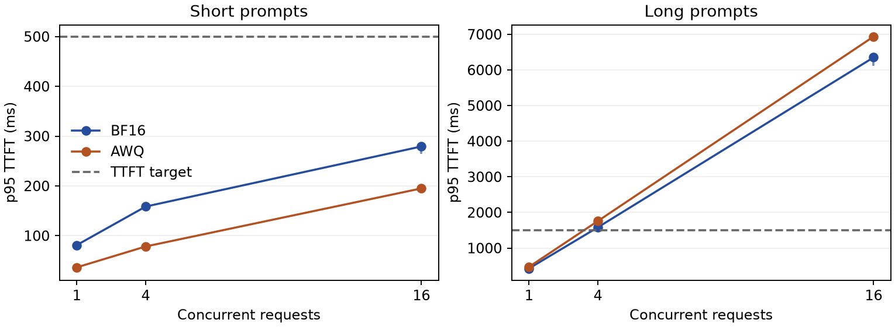

# Qwen3-8B BF16 and AWQ streaming

GPU: NVIDIA L4, GPU-c17fb771-31e2-7df9-854c-a0be9f6ff71d, 23034 MiB, 580.126.20. vLLM 0.11.2, CUDA 12.9.

Vertical ranges show the observed p95s across repeat blocks.

| Variant | Workload | Concurrency | Requests | Errors | p50 TTFT (ms) | p95 TTFT (ms) | Output tok/s | Goodput (req/s) | Input tokens |
|---|---|---:|---:|---:|---:|---:|---:|---:|---|
| BF16 | long | 1 | 32 | 0 | 418.1 | 426.5 | 14.68 | 0.23 | 1342–1342 |
| BF16 | long | 4 | 32 | 0 | 830.5 | 1582.1 | 43.74 | 0.60 | 1342–1342 |
| BF16 | long | 16 | 32 | 0 | 3586.9 | 6351.7 | 90.57 | 0.22 | 1342–1342 |
| BF16 | short | 1 | 32 | 0 | 79.7 | 81.1 | 16.11 | 0.25 | 31–33 |
| BF16 | short | 4 | 32 | 0 | 145.7 | 158.5 | 60.00 | 0.94 | 31–33 |
| BF16 | short | 16 | 32 | 0 | 264.0 | 279.2 | 226.98 | 3.55 | 31–33 |
| AWQ | long | 1 | 32 | 0 | 460.8 | 470.7 | 28.68 | 0.45 | 1342–1342 |
| AWQ | long | 4 | 32 | 0 | 873.8 | 1758.8 | 71.60 | 0.98 | 1342–1342 |
| AWQ | long | 16 | 32 | 0 | 4022.8 | 6937.3 | 108.64 | 0.32 | 1342–1342 |
| AWQ | short | 1 | 32 | 0 | 33.6 | 36.4 | 38.25 | 0.60 | 31–33 |
| AWQ | short | 4 | 32 | 0 | 64.4 | 78.4 | 131.87 | 2.06 | 31–33 |
| AWQ | short | 16 | 32 | 0 | 185.6 | 195.0 | 495.28 | 7.74 | 31–33 |

Exact match on 40 paired prompts was 70.0% for BF16 and 82.5% for AWQ. The AWQ-minus-BF16 difference was +12.5 points (paired bootstrap 95% interval +2.5 to +22.5 points). The set contains synthetic factual extraction and arithmetic tasks.

- **Short prompts (500 ms target).** AWQ at concurrency 16 had the highest observed goodput, 7.74 req/s.
- **Long prompts (1500 ms target).** AWQ at concurrency 4 had the highest observed goodput, 0.98 req/s.
  Its p95 was 1758.8 ms. With a p95 ceiling of 1500 ms, choose AWQ at concurrency 1 for 0.45 req/s.

See [the benchmark protocol](../../docs/benchmark-reproduction.md) for the request and scoring definitions. Per-request samples and repeat blocks are in the variant folders.
